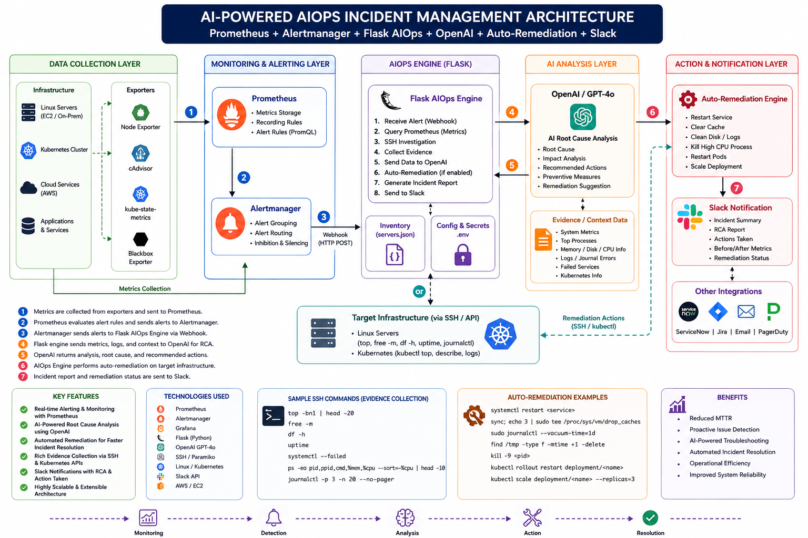
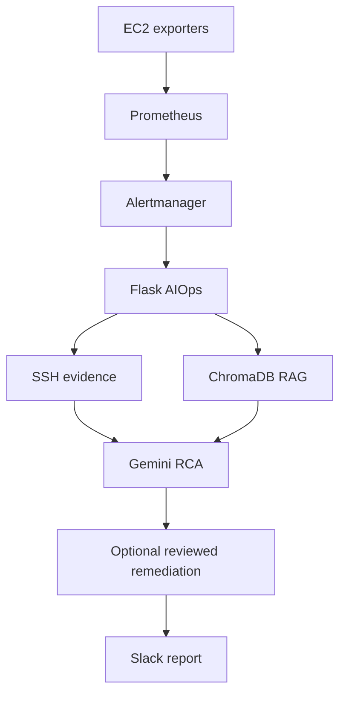

# 🤖 AI-Powered AIOps Incident Management Platform

Build an AWS EC2 monitoring and incident-response lab with Prometheus, Grafana, Alertmanager, a Flask AIOps service, Google Gemini, SSH evidence collection, ChromaDB runbooks, and Slack notifications.



> **Use this guide in order.** Each phase replaces `/opt/aiops/app.py` with that phase's version, so always use the latest `app.py` example for the phase you are completing. Run commands on the host named in the step. Replace every ALL-CAPS placeholder (for example, `TEST_1_PRIVATE_IP`) with your own value before pasting. Keep `AUTO_REMEDIATE=false` unless you have reviewed and explicitly approved each action. This is a lab guide, not a production-ready deployment.

## Deployment path

| Step | Guide section | Result |
| --- | --- | --- |
| 0 | [Before you begin](#before-you-begin) | AWS instances, access, Slack webhook, and required values are ready |
| 1 | [Monitoring and alerting](#phase-1--monitoring--alerting-stack) | Prometheus, Grafana, Alertmanager, Node Exporter, and Slack |
| 2 | [Gemini RCA](#phase-2--ai-service-flask--gemini-rca-with-prometheus-metrics) | Flask service analyzes alerts and Prometheus metrics |
| 3 | [SSH investigation](#phase-3--advanced-rca-ssh-based-investigation) | AIOps gathers evidence from monitored EC2 instances |
| 4 | [Auto-remediation](#phase-4--auto-remediation) | Optional, explicitly controlled recovery actions |
| 5 | [Nginx and RAG](#phase-5--nginx-example-rag-runbook-chromadb) | Nginx alerts and ChromaDB runbook retrieval |
| Help | [Troubleshooting](#troubleshooting--errors) | Service checks and common fixes |
| Reference | [SRE concepts](#appendix--sre-concepts) | SRE terminology |

## Before you begin

### What you need

- An AWS account with permission to launch EC2 instances, configure security groups, and create/attach an IAM role.
- One Amazon Linux 2023 **monitoring server** and two Amazon Linux 2023 **test servers**. The examples use `c7i-flex.large` with a 30 GB disk for monitoring and `t3.micro` for each test server; select sizes appropriate for your lab.
- An EC2 instance profile on the monitoring server with `ec2:DescribeInstances` permission. Add `ec2:DescribeAvailabilityZones` only if required by your discovery setup.
- A Slack workspace and Incoming Webhook URL. Create an app at [api.slack.com/apps](https://api.slack.com/apps/), enable Incoming Webhooks, add a webhook to your channel, and keep the URL private.
- A Google Gemini API key for Phases 2–5. Create one at [aistudio.google.com/apikey](https://aistudio.google.com/apikey).
- An SSH key pair and the ability to connect from the monitoring server to each test server using its private IP.

### Security group checklist

Use the monitoring server's security group as the source for internal monitoring and SSH traffic. Restrict browser-facing ports to **your own IP**; do not expose these lab services to `0.0.0.0/0`.

| Destination | Port | Allow from |
| --- | ---: | --- |
| Test servers: SSH | 22 | Monitoring server security group (and your IP only when needed) |
| Test servers: Node Exporter | 9100 | Monitoring server security group |
| Nginx test server: exporter | 9113 | Monitoring server security group |
| Monitoring server: Prometheus UI | 9090 | Your IP |
| Monitoring server: Alertmanager UI | 9093 | Your IP |
| Monitoring server: Grafana UI | 3000 | Your IP |

The AIOps Flask service listens on `127.0.0.1:5000` in the examples, so Alertmanager can call it on the monitoring host. Do not open port 5000 to the public internet.

### Prepare your values

Keep a note of these values. Use private IPs for communication between EC2 instances and the monitoring server's public IP only when opening the web dashboards in your browser.

| Placeholder | Replace with |
| --- | --- |
| `MONITORING_PUBLIC_IP` | Public IPv4 address of the monitoring server |
| `TEST_1_PRIVATE_IP` / `TEST_2_PRIVATE_IP` | Private IPv4 addresses of the test servers |
| `SLACK_WEBHOOK_URL` | Slack Incoming Webhook URL |
| `GEMINI_API_KEY` | Google Gemini API key |
| `AWS_REGION` | AWS region containing the EC2 instances |

### Copy/paste conventions

1. Copy one complete command block at a time into the correct server's SSH terminal.
2. Blocks marked **Monitoring server** run on the monitoring EC2 instance; blocks marked **Test server** run on the named target.
3. For file examples, open the named file, replace the relevant content with the complete fenced code block, save it, and then run the validation/restart commands that follow.
4. Do not paste prompt text, explanatory lines, or Markdown fences into a shell.
5. Keep API keys, webhook URLs, and private SSH keys out of Git and chat logs. Do not commit `.env`, `.pem`, or private key files.

## Overview

The project receives infrastructure alerts, enriches them with metrics and (in later phases) SSH evidence and runbook context, then posts an analysis to Slack.

### Files in this repository

| File | Purpose |
| --- | --- |
| `architecture.png` | AIOps architecture diagram |
| `node-exporter.sh.txt` | Node Exporter installation commands for each test server |
| `Implementation.txt` | Additional project implementation notes |
| `README.md` | Phased deployment instructions and the monitoring-server installation script |



### Technology stack

| Layer | Technology |
| --- | --- |
| Monitoring and dashboards | Prometheus, Grafana |
| Alert routing | Alertmanager |
| AIOps API | Flask |
| AI analysis | Google Gemini |
| Evidence collection | SSH, Paramiko, Linux tools |
| Runbook retrieval | ChromaDB, Gemini embeddings |
| Notifications | Slack |
| Infrastructure | AWS EC2 |

## Phase 1 — Monitoring & Alerting Stack

### Step 1: Launch and tag the EC2 instances

1. Launch one Amazon Linux 2023 instance for the **monitoring server**.
2. Launch two Amazon Linux 2023 instances for **Test-1** and **Test-2**.
3. Set the EC2 **Name** tags to `Test-1` and `Test-2` respectively. The AIOps inventory in Phase 3 uses these exact names.
4. Add this EC2 tag to both test instances:

   | Key | Value |
   | --- | --- |
   | `monitor` | `node_server` |

5. Attach the EC2 discovery role described in [What you need](#what-you-need) to the monitoring server.
6. Configure the security groups using the [Security group checklist](#security-group-checklist).
7. Note each instance's private IP address and the monitoring server's public IP.

### Step 2: Create a Slack Incoming Webhook

Create a Slack app, enable **Incoming Webhooks**, add a webhook for the channel where you want alerts, and copy the webhook URL. Keep it private; you will enter it on the monitoring server in the next step.

### Step 3: Install the monitoring stack

**On the monitoring server:** first edit `REGION` in the [`allinoneinstallation.sh` script](#script-allinoneinstallationsh-monitoring-server) to match your `AWS_REGION`. Save the complete script shown below as `/tmp/allinoneinstallation.sh`. For example, open an editor with `sudo vi /tmp/allinoneinstallation.sh`, paste the entire script block, save and exit (`Esc`, `:wq`, `Enter`), then run:

```bash
read -rsp "Slack Incoming Webhook URL: " SLACK_WEBHOOK_URL; echo
export SLACK_WEBHOOK_URL
sudo --preserve-env=SLACK_WEBHOOK_URL bash /tmp/allinoneinstallation.sh
unset SLACK_WEBHOOK_URL
```

The script installs and configures Prometheus, Alertmanager, Grafana, and a local Node Exporter. It also creates low-threshold CPU, memory, and disk demo alerts. Review the script before running it; it updates packages and writes system configuration.

### Step 4: Install Node Exporter on both test servers

**On each test server:** copy and run the complete [`node-exporter.sh` script](#script-node-exportersh-test-servers) shown below. Confirm the service is active:

```bash
sudo systemctl status node_exporter --no-pager
```

Repeat on Test-1 and Test-2. The monitoring server discovers them through the `monitor=node_server` tag.

### Step 5: Verify targets and dashboards

1. Open `http://MONITORING_PUBLIC_IP:9090/targets`. Confirm both test Node Exporter targets are **UP**.
2. Open `http://MONITORING_PUBLIC_IP:9090/alerts`. Demo alerts may show **Pending** and then **Firing** because the example thresholds are intentionally low.
3. Open `http://MONITORING_PUBLIC_IP:9093` to check Alertmanager.
4. Open `http://MONITORING_PUBLIC_IP:3000` to sign in to Grafana. The install example uses `admin` / `admin`; change the password at first login.
5. In Grafana, add a Prometheus data source with URL `http://localhost:9090`, then save and test it.
6. Confirm a test notification arrives in your Slack channel.

### Step 6: Validate configuration changes

After editing Prometheus rules or configuration, validate them before restarting the service:

```bash
sudo promtool check config /etc/prometheus/prometheus.yml
sudo promtool check rules /etc/prometheus/alert.rules.yml
sudo systemctl restart prometheus
sudo systemctl status prometheus --no-pager
```

After editing Alertmanager configuration:

```bash
sudo amtool check-config /etc/alertmanager/alertmanager.yml
sudo systemctl restart alertmanager
sudo systemctl status alertmanager --no-pager
```

---

### Phase 1 troubleshooting

```bash
aws ec2 describe-instances --region ap-south-1 | grep node_server
```

Any changes in the rules

```bash
vi /etc/prometheus/alert.rules.yml
```

```bash
promtool check rules /etc/prometheus/alert.rules.yml
```

```bash
systemctl restart prometheus
```

Alertmanager config  -> /etc/alertmanager/alertmanager.yml
Prometheus rules     -> /etc/prometheus/alert.rules.yml

#### Repair the Grafana repository

```bash
grep -R "grafana" /etc/yum.repos.d/
```

```bash
sudo rm -f /etc/yum.repos.d/grafana.repo
```

```bash
sudo rm -f /etc/yum.repos.d/*grafana*
```

ls -l /etc/yum.repos.d/

```bash
sudo dnf clean all
```

```bash
sudo rm -rf /var/cache/dnf
```

```bash
sudo tee /etc/yum.repos.d/grafana.repo >/dev/null <<'EOF'
```

[grafana]
name=Grafana
baseurl=https://rpm.grafana.com
enabled=1
gpgcheck=1
repo_gpgcheck=1
gpgkey=https://rpm.grafana.com/gpg.key
EOF

```bash
cat /etc/yum.repos.d/grafana.repo
```

```bash
sudo dnf makecache
```

```bash
sudo dnf repolist
```

---------------------------------------

### Script: `allinoneinstallation.sh` (monitoring server)

```bash
#!/bin/bash

set -e

PROM_VERSION="2.55.1"
ALERT_VERSION="0.27.0"
NODE_VERSION="1.11.1"
REGION="ap-south-1"

SLACK_WEBHOOK_URL="${SLACK_WEBHOOK_URL:?Please export SLACK_WEBHOOK_URL first}"

WORKDIR="/opt/monitoring"

echo "========================================="
echo " Installing Monitoring Stack"
echo "========================================="

sudo mkdir -p ${WORKDIR}
cd ${WORKDIR}

############################################
# Update OS
############################################

sudo dnf update -y

############################################
# Prometheus User
############################################

sudo useradd --no-create-home --shell /sbin/nologin prometheus || true
sudo useradd --no-create-home --shell /sbin/nologin node_exporter || true

############################################
# Prometheus
############################################

cd ${WORKDIR}

curl -LO https://github.com/prometheus/prometheus/releases/download/v${PROM_VERSION}/prometheus-${PROM_VERSION}.linux-amd64.tar.gz

tar -xzf prometheus-${PROM_VERSION}.linux-amd64.tar.gz

cd prometheus-${PROM_VERSION}.linux-amd64

sudo mkdir -p /etc/prometheus
sudo mkdir -p /var/lib/prometheus

sudo cp prometheus /usr/local/bin/
sudo cp promtool /usr/local/bin/

sudo cp -r consoles /etc/prometheus/
sudo cp -r console_libraries /etc/prometheus/

sudo chown -R prometheus:prometheus /etc/prometheus
sudo chown -R prometheus:prometheus /var/lib/prometheus

############################################
# Alertmanager
############################################

cd ${WORKDIR}

curl -LO https://github.com/prometheus/alertmanager/releases/download/v${ALERT_VERSION}/alertmanager-${ALERT_VERSION}.linux-amd64.tar.gz

tar -xzf alertmanager-${ALERT_VERSION}.linux-amd64.tar.gz

cd alertmanager-${ALERT_VERSION}.linux-amd64

sudo cp alertmanager /usr/local/bin/
sudo cp amtool /usr/local/bin/

sudo mkdir -p /etc/alertmanager
sudo mkdir -p /var/lib/alertmanager
sudo chown -R prometheus:prometheus /var/lib/alertmanager

############################################
# Node Exporter
############################################

cd ${WORKDIR}

curl -LO https://github.com/prometheus/node_exporter/releases/download/v${NODE_VERSION}/node_exporter-${NODE_VERSION}.linux-amd64.tar.gz

tar -xzf node_exporter-${NODE_VERSION}.linux-amd64.tar.gz

cd node_exporter-${NODE_VERSION}.linux-amd64

sudo cp node_exporter /usr/local/bin/

sudo chown node_exporter:node_exporter /usr/local/bin/node_exporter

############################################
# Alert Rules
############################################

sudo tee /etc/prometheus/alert.rules.yml > /dev/null <<'EOF'
groups:

- name: system-alerts

  rules:

  - alert: InstanceDown
    expr: up == 0
    for: 1m
    labels:
      severity: critical
    annotations:
      summary: "Instance Down"
      description: "{{ $labels.instance }} is down"

  - alert: HighCPUUsage
    expr: (100 - (avg by(instance)(rate(node_cpu_seconds_total{mode="idle"}[2m])) * 100)) > 10
    for: 2m
    labels:
      severity: warning
    annotations:
      summary: "High CPU Usage"
      description: "{{ $labels.instance }} CPU above 10%"

  - alert: HighMemoryUsage
    expr: (1 - (node_memory_MemAvailable_bytes/node_memory_MemTotal_bytes)) * 100 > 10
    for: 2m
    labels:
      severity: warning
    annotations:
      summary: "High Memory Usage"
      description: "{{ $labels.instance }} Memory above 10%"

  - alert: HighDiskUsage
    expr: |
      (1 - (
        node_filesystem_avail_bytes{fstype!~"tmpfs|overlay"}
        /
        node_filesystem_size_bytes{fstype!~"tmpfs|overlay"}
      )) * 100 > 10
    for: 2m
    labels:
      severity: warning
    annotations:
      summary: "High Disk Usage"
      description: "{{ $labels.instance }} Disk above 10%"
EOF

############################################
# Alertmanager Config
############################################

sudo tee /etc/alertmanager/alertmanager.yml > /dev/null <<EOF
global:
  resolve_timeout: 5m

route:
  receiver: slack
  group_by:
    - alertname
  group_wait: 10s
  group_interval: 30s
  repeat_interval: 1h

receivers:
- name: slack
  slack_configs:
  - api_url: '${SLACK_WEBHOOK_URL}'
    send_resolved: false
    title: '[{{ .Status | toUpper }}] {{ .GroupLabels.alertname }}'
    text: |
      {{ range .Alerts }}
      🚨 *Alert:* {{ .Labels.alertname }}

      *Instance:* {{ .Labels.instance }}
      *Severity:* {{ .Labels.severity }}

      *Summary:* {{ .Annotations.summary }}
      *Description:* {{ .Annotations.description }}

      ------------------------------------
      {{ end }}
EOF

############################################
# Prometheus Config
############################################

sudo tee /etc/prometheus/prometheus.yml > /dev/null <<EOF
global:
  scrape_interval: 15s

rule_files:
  - "alert.rules.yml"

alerting:
  alertmanagers:
    - static_configs:
        - targets:
          - localhost:9093

scrape_configs:

  - job_name: prometheus
    static_configs:
      - targets:
        - localhost:9090

  - job_name: ec2-node-exporters

    ec2_sd_configs:
      - region: ${REGION}
        port: 9100

        filters:
          - name: tag:monitor
            values:
              - node_server

    relabel_configs:

      - source_labels:
          [__meta_ec2_private_ip]

        target_label: __address__
        replacement: \$1:9100

      - source_labels:
          [__meta_ec2_tag_Name]

        target_label: instance
EOF

############################################
# Prometheus Service
############################################

sudo tee /etc/systemd/system/prometheus.service > /dev/null <<'EOF'
[Unit]
Description=Prometheus
After=network-online.target

[Service]
User=prometheus
Group=prometheus

ExecStart=/usr/local/bin/prometheus \
 --config.file=/etc/prometheus/prometheus.yml \
 --storage.tsdb.path=/var/lib/prometheus \
 --web.enable-lifecycle

Restart=always

[Install]
WantedBy=multi-user.target
EOF

############################################
# Alertmanager Service
############################################

sudo tee /etc/systemd/system/alertmanager.service > /dev/null <<'EOF'
[Unit]
Description=Alertmanager

[Service]
User=prometheus

ExecStart=/usr/local/bin/alertmanager \
 --config.file=/etc/alertmanager/alertmanager.yml \
 --storage.path=/var/lib/alertmanager

Restart=always

[Install]
WantedBy=multi-user.target
EOF

############################################
# Node Exporter Service
############################################

sudo tee /etc/systemd/system/node_exporter.service > /dev/null <<'EOF'
[Unit]
Description=Node Exporter
After=network-online.target

[Service]
User=node_exporter

ExecStart=/usr/local/bin/node_exporter

Restart=always

[Install]
WantedBy=multi-user.target
EOF

############################################
# Grafana
############################################
sudo tee /etc/yum.repos.d/grafana.repo >/dev/null <<'EOF'
[grafana]
name=Grafana
baseurl=https://rpm.grafana.com
enabled=1
gpgcheck=1
repo_gpgcheck=1
gpgkey=https://rpm.grafana.com/gpg.key
EOF
sudo dnf install -y grafana
############################################
# Validation
############################################

sudo /usr/local/bin/promtool check config /etc/prometheus/prometheus.yml
sudo /usr/local/bin/promtool check rules /etc/prometheus/alert.rules.yml
sudo /usr/local/bin/amtool check-config /etc/alertmanager/alertmanager.yml

############################################
# Start Services
############################################

sudo systemctl daemon-reload

sudo systemctl enable prometheus --now
sudo systemctl enable alertmanager --now
sudo systemctl enable node_exporter --now
sudo systemctl enable grafana-server --now

############################################
# Status
############################################

echo ""
echo "========================================="
echo "Installation Completed"
echo "========================================="
echo "Prometheus   : http://$(curl -s http://169.254.169.254/latest/meta-data/public-ipv4):9090"
echo "Grafana      : http://$(curl -s http://169.254.169.254/latest/meta-data/public-ipv4):3000"
echo "Alertmanager : http://$(curl -s http://169.254.169.254/latest/meta-data/public-ipv4):9093"
echo ""
echo "Grafana Login"
echo "Username : admin"
echo "Password : admin"
echo "========================================="
```

### Script: `node-exporter.sh` (test servers)

```bash
#NODEEXPORTER
wget https://github.com/prometheus/node_exporter/releases/download/v1.5.0/node_exporter-1.5.0.linux-amd64.tar.gz
tar -xf node_exporter-1.5.0.linux-amd64.tar.gz
sudo mv node_exporter-1.5.0.linux-amd64/node_exporter  /usr/local/bin
rm -rv node_exporter-1.5.0.linux-amd64*
sudo useradd -rs /bin/false node_exporter

sudo cat <<EOF | sudo tee /etc/systemd/system/node_exporter.service
[Unit]
Description=Node Exporter
After=network.target

[Service]
User=node_exporter
Group=node_exporter
Type=simple
ExecStart=/usr/local/bin/node_exporter

[Install]
WantedBy=multi-user.target
EOF

sudo cat /etc/systemd/system/node_exporter.service
sudo systemctl daemon-reload  && sudo systemctl enable node_exporter
sudo systemctl start node_exporter.service && sudo systemctl status node_exporter.service --no-pager
```

---

## Phase 2 — AI Service (Flask + Gemini RCA with Prometheus metrics)

### Install the AIOps application on the monitoring server

```bash
mkdir -p /opt/aiops
```

```bash
cd /opt/aiops
```

```bash
dnf install python3-pip -y
```

```bash
python3 -m venv /opt/aiops/venv
```

```bash
source /opt/aiops/venv/bin/activate
```

```bash
python3 -m pip install flask requests gunicorn
```

### Create AI Application

Now Monitoring Server is sending alerts to Slack instead let it send to AI agent

Note: replace your slack webhook

```bash
vi /opt/aiops/app.py
```

```python
from flask import Flask, request
import requests

app = Flask(__name__)

SLACK_WEBHOOK = "https://hooks.slack.com/services/YOUR/SLACK/WEBHOOK"

@app.route("/alert", methods=["POST"])
def alert():

    data = request.json

    alert = data["alerts"][0]

    alert_name = alert["labels"].get("alertname","Unknown")
    severity = alert["labels"].get("severity","warning")

    message = f"""
🚨 AI Incident Analysis

Alert: {alert_name}

Severity: {severity}

Possible Causes:
- High workload
- Resource exhaustion
- Application issue

Recommended Actions:
- Check system resources
- Verify application logs
- Scale if required

Generated By: AIOps Engine
"""

    requests.post(
        SLACK_WEBHOOK,
        json={"text": message}
    )

    return {"status":"received"}

if __name__ == "__main__":
    app.run(
        host="127.0.0.1",
        port=5000
    )
```

```bash
/opt/aiops/venv/bin/python3 /opt/aiops/app.py   # keep the application running
```

Open another terminal

### Configure Alertmanager

Alertmanager is a component of the Prometheus ecosystem responsible for receiving alerts from Prometheus and deciding what to do with them.

Think of it as the notification and alert orchestration engine.

```bash
vi /etc/alertmanager/alertmanager.yml
```

replace with this code - we are removing slack here and adding AI agent application

```yaml
global:
  resolve_timeout: 5m

route:
  receiver: aiops

receivers:

- name: aiops

  webhook_configs:

  - url: "http://localhost:5000/alert"
```

```bash
systemctl restart alertmanager
```

```bash
systemctl status alertmanager
```

See the Alerts in Alert manager and Prometheus

### Create Test Alert

```bash
vi /etc/prometheus/alert.rules.yml
```

```yaml
  - alert: TestAI
    expr: vector(1)
    for: 10s
    labels:
      severity: critical
    annotations:
      summary: "Testing AI"
```

```bash
promtool check rules /etc/prometheus/alert.rules.yml
```

### Reload Prometheus

```bash
curl -X POST http://localhost:9090/-/reload
```

```bash
sudo systemctl restart prometheus  # use lowercase prometheus
```

Verify Alert --> in alert manager and in Prometheus and in slack

### Note: first ctrl C for already running python program in another tab

### Run Python as Background Service

```bash
vi /etc/systemd/system/aiops.service
```

```ini
[Unit]
Description=AIOps Service
After=network.target

[Service]
User=root
WorkingDirectory=/opt/aiops

ExecStart=/opt/aiops/venv/bin/python3 /opt/aiops/app.py

Restart=always

[Install]
WantedBy=multi-user.target
```

```bash
systemctl daemon-reload
```

```bash
systemctl enable aiops
```

```bash
systemctl start aiops
```

```bash
systemctl status aiops   # for troubleshooting
```

Whenever an alert arrives you'll see:
POST /alert HTTP/1.1 200

```bash
journalctl -u aiops -f
```

```bash
journalctl -u aiops -n 100 --no-pager
```

### Make It Real

Generate actual infrastructure issues.

High CPU

### On TEST EC2

```bash
dnf install stress -y
```

```bash
stress --cpu 4 --timeout 300
```

Refresh Prometheus Page: HighCPUUsage --> pending --> firing.

see the Alerts now, if no alerts check the logs, if any permission issue

Do this on monitoringServer

```bash
sudo journalctl -u alertmanager -f
```

```bash
sudo systemctl stop alertmanager
```

```bash
sudo mkdir -p /var/lib/alertmanager
sudo chown -R prometheus:prometheus /var/lib/alertmanager
```

```bash
sudo chmod 750 /var/lib/alertmanager
```

```bash
sudo systemctl start alertmanager
```

```bash
sudo systemctl status alertmanager
```

We already have:

✅ Prometheus
✅ Grafana
✅ Alertmanager
✅ Slack
✅ Python AIOps Service

Now we will transform it into a real AIOps platform where AI performs Root Cause Analysis (RCA) using live Prometheus metrics.

### Phase 2 Architecture (Real AIOps)

EC2 Servers
     |
Node Exporter
     |
Prometheus
     |
Alertmanager
     |
Webhook
     |
AIOps Service
     |
     +--> Query Prometheus API
     |
     +--> Collect CPU
     |
     +--> Collect Memory
     |
     +--> Collect Disk
     |
     +--> Send Metrics to AI
     |
     +--> Generate RCA
     |
Slack

```bash
cd /opt/aiops
```

```bash
source /opt/aiops/venv/bin/activate
```

### Install Packages

```bash
python3 -m pip install flask requests google-genai
```

```bash
python3 -m pip list | grep -E "flask|requests|google-genai"
```

Get Gemini API Key
https://aistudio.google.com/apikey
------------------

```bash
export GEMINI_API_KEY="YOUR_GEMINI_API_KEY"
```

Make the key permanent under .env file

```bash
vi /opt/aiops/.env
```

GEMINI_API_KEY="YOUR_GEMINI_API_KEY"
GEMINI_MODEL=gemini-flash-lite-latest
GEMINI_EMBEDDING_MODEL=gemini-embedding-001
SLACK_WEBHOOK=https://hooks.slack.com/services/YOUR/SLACK/WEBHOOK
AUTO_REMEDIATE=false

### Create Enhanced AI Service

Note: change slack URL and API Key

```bash
vi /opt/aiops/app.py
```

```python
from flask import Flask, request
import requests
import os
from google import genai
from google.genai import types

app = Flask(__name__)

PROM_URL = "http://localhost:9090"

SLACK_WEBHOOK = "https://hooks.slack.com/services/YOUR/SLACK/WEBHOOK"

client = genai.Client(api_key=os.getenv("GEMINI_API_KEY"), http_options=types.HttpOptions(timeout=30000))

def query_prometheus(query):

    response = requests.get(
        f"{PROM_URL}/api/v1/query",
        params={"query": query}
    )

    return response.json()

@app.route("/alert", methods=["POST"])
def alert():

    data = request.json

    alert = data["alerts"][0]

    alert_name = alert["labels"]["alertname"]

    cpu_query = """
    100 - (
    avg(rate(node_cpu_seconds_total{mode="idle"}[2m])) * 100
    )
    """

    memory_query = """
    (
    (
    node_memory_MemTotal_bytes
    -
    node_memory_MemAvailable_bytes
    )
    /
    node_memory_MemTotal_bytes
    ) * 100
    """

    disk_query = """
    (
    (
    node_filesystem_size_bytes
    -
    node_filesystem_avail_bytes
    )
    /
    node_filesystem_size_bytes
    ) * 100
    """

    cpu = query_prometheus(cpu_query)
    memory = query_prometheus(memory_query)
    disk = query_prometheus(disk_query)

    prompt = f"""
You are a Senior SRE.

Alert:
{alert_name}

Current Metrics:

CPU:
{cpu}

Memory:
{memory}

Disk:
{disk}

Provide:

1. Root Cause
2. Impact
3. Recommended Fix
4. Severity
"""

    result = client.models.generate_content(
        model=os.getenv("GEMINI_MODEL", "gemini-flash-lite-latest"),
        contents=prompt
    )

    analysis = result.text

    requests.post(
        SLACK_WEBHOOK,
        json={"text": analysis}
    )

    return {"status":"ok"}

if __name__ == "__main__":
    app.run(
        host="127.0.0.1",
        port=5000
    )
```

### Create Service

```bash
vi /etc/systemd/system/aiops.service
```

```ini
[Unit]
Description=AIOps Service
After=network.target

[Service]
WorkingDirectory=/opt/aiops
EnvironmentFile=/opt/aiops/.env

ExecStart=/opt/aiops/venv/bin/python3 /opt/aiops/app.py

Restart=always

[Install]
WantedBy=multi-user.target
```

```bash
systemctl daemon-reload
```

```bash
systemctl enable aiops
```

```bash
systemctl restart aiops
```

```bash
systemctl status aiops
```

### Configure Alertmanager

```bash
vi /etc/alertmanager/alertmanager.yml
```

```yaml
global:
  resolve_timeout: 5m

route:
  receiver: aiops

receivers:

- name: aiops

  webhook_configs:

  - url: "http://localhost:5000/alert"
```

```bash
systemctl restart alertmanager
```

### Generate Real CPU Alert

On Test-1 Server

```bash
stress --cpu 4 --timeout 300
```

Now see Prometheus showing HigCPUUsage as yellow pending

see in the slack now

---

## Phase 3 — Advanced RCA (SSH-Based Investigation)

### Incident data flow

Instead of:

Alert → AI Service → Slack

we do now

Alert
   ↓
AI Service
   ↓
Connect to Affected EC2
   ↓
Collect Live Evidence
   ↓
Analyze with AI
   ↓
Generate RCA
   ↓
Slack

EC2 Servers
    |
Node Exporter
    |
Prometheus
    |
Alertmanager
    |
Webhook
    |
AIOps Python Service
    |
    +--> Prometheus Metrics
    |
    +--> SSH to EC2
             |
             +--> top
             +--> free -m
             +--> df -h
             +--> uptime
             +--> systemctl status
    |
    +--> Gemini
    |
Slack

### Configure SSH evidence collection

### Install the SSH dependency on the monitoring server

```bash
source /opt/aiops/venv/bin/activate
python3 -m pip install paramiko
python3 -m pip show paramiko
```

Generate the key as `root` because the example systemd service runs as root and the SSH helper reads `/root/.ssh/id_rsa`. If this key already exists, do not overwrite it; reuse it or choose a different key path and update `KEY` in `ssh_client.py`.

```bash
sudo install -d -m 700 /root/.ssh
sudo ssh-keygen -t rsa -b 4096 -f /root/.ssh/id_rsa -N ""
sudo chmod 600 /root/.ssh/id_rsa
sudo cat /root/.ssh/id_rsa.pub
```

Copy the **public** key line printed by the command. Never copy or share `/root/.ssh/id_rsa` (the private key).

On **each target EC2**, sign in as `ec2-user` (do not use `sudo` for these home-directory commands) and append the copied public key. Replace the placeholder with the complete public key line:

```bash
mkdir -p ~/.ssh
chmod 700 ~/.ssh
touch ~/.ssh/authorized_keys
echo 'PASTE_MONITORING_SERVER_PUBLIC_KEY_HERE' >> ~/.ssh/authorized_keys
chmod 600 ~/.ssh/authorized_keys
```

Preserve any existing lines in `authorized_keys`. Repeat on Test-1 and Test-2.

From the monitoring server, verify access to both private IP addresses:

```bash
sudo ssh -i /root/.ssh/id_rsa ec2-user@TEST_1_PRIVATE_IP
sudo ssh -i /root/.ssh/id_rsa ec2-user@TEST_2_PRIVATE_IP
```

On the first connection, verify the host fingerprint before accepting it. Exit each SSH session before testing the next host. Confirm port 22 allows traffic from the monitoring server's security group.

### Create the server inventory on the monitoring server

```bash
sudo vi /opt/aiops/servers.json
```

```json
{
  "Test-1": {
    "host": "TEST_1_PRIVATE_IP",
    "user": "ec2-user"
  },

  "Test-2": {
    "host": "TEST_2_PRIVATE_IP",
    "user": "ec2-user"
  }
}
```

### Create the SSH helper on the monitoring server

```bash
sudo vi /opt/aiops/ssh_client.py
```

```python
import paramiko

KEY = "/root/.ssh/id_rsa"


def run_command(host, user, command):
    ssh = paramiko.SSHClient()
    ssh.load_system_host_keys()
    try:
        ssh.connect(hostname=host, username=user, key_filename=KEY, timeout=10)
        _, stdout, stderr = ssh.exec_command(command, timeout=15)
        output = stdout.read().decode()
        error = stderr.read().decode()
        if error:
            output = f"{output}\n{error}".strip()
        return output
    finally:
        ssh.close()
```

### Test SSH collection

```bash
sudo vi /opt/aiops/test.py
```

```python
from ssh_client import run_command

print(run_command("TEST_1_PRIVATE_IP", "ec2-user", "uptime"))
```

```bash
/opt/aiops/venv/bin/python3 /opt/aiops/test.py
```

### Collect sample server data

```bash
sudo vi /opt/aiops/collect.py
```

```python
from ssh_client import run_command

host = "TEST_1_PRIVATE_IP"

print(run_command(host, "ec2-user", "top -bn1 | head -15"))
print(run_command(host, "ec2-user", "free -m"))
print(run_command(host, "ec2-user", "df -h"))
print(run_command(host, "ec2-user", "uptime"))
print(run_command(host, "ec2-user", "systemctl --failed"))
```

```bash
/opt/aiops/venv/bin/python3 /opt/aiops/collect.py
```

### Restart and check the AIOps service

```bash
sudo systemctl restart aiops
sudo systemctl status aiops --no-pager
sudo journalctl -u aiops -n 100 --no-pager
```

### Add the ENV variables - slack webhook and Gemini key

```bash
vi /etc/systemd/system/aiops.service
```

```ini
[Unit]
Description=AIOps Service
After=network.target

[Service]
WorkingDirectory=/opt/aiops
EnvironmentFile=/opt/aiops/.env

ExecStart=/opt/aiops/venv/bin/python3 /opt/aiops/app.py

Restart=always

[Install]
WantedBy=multi-user.target
```

```bash
systemctl daemon-reexec
```

```bash
systemctl daemon-reload
```

```bash
systemctl restart aiops
```

Note: Do not change anything below, because we used env var above for slack and Gemini

```bash
vi app.py
```

```python
from flask import Flask, request
import requests
import json
import os

from google import genai
from google.genai import types

from ssh_client import run_command

app = Flask(__name__)

PROM_URL = "http://localhost:9090"

SLACK_WEBHOOK = os.getenv("SLACK_WEBHOOK")

GEMINI_KEY = os.getenv("GEMINI_API_KEY")

client = genai.Client(api_key=GEMINI_KEY, http_options=types.HttpOptions(timeout=30000))

# ---------------------------
# Load inventory
# ---------------------------

with open("/opt/aiops/servers.json") as f:
    INVENTORY = json.load(f)

# ---------------------------
# Query Prometheus
# ---------------------------

def query_prometheus(query):

    try:

        response = requests.get(
            f"{PROM_URL}/api/v1/query",
            params={"query": query},
            timeout=10
        )

        return response.json()

    except Exception as e:

        return {
            "error": str(e)
        }

# ---------------------------
# Slack Notification
# ---------------------------

def send_slack(message):

    try:

        requests.post(
            SLACK_WEBHOOK,
            json={"text": message},
            timeout=10
        )

    except Exception as e:

        print("Slack Error:", e)

# ---------------------------
# Alert Endpoint
# ---------------------------

@app.route("/alert", methods=["POST"])
def alert():

    try:

        data = request.json

        alert = data["alerts"][0]

        alert_name = alert["labels"].get(
            "alertname",
            "Unknown"
        )

        severity = alert["labels"].get(
            "severity",
            "warning"
        )

        instance = alert["labels"].get(
            "instance",
            "node_server"
        )

        # ---------------------------
        # Get Server Details
        # ---------------------------

        if instance in INVENTORY:

            host = INVENTORY[instance]["host"]

            user = INVENTORY[instance]["user"]

        else:

            host = "UNKNOWN"

            user = "UNKNOWN"

        # ---------------------------
        # Prometheus Metrics
        # ---------------------------

        cpu_metric = query_prometheus(
            '100 - (avg(rate(node_cpu_seconds_total{mode="idle"}[2m])) * 100)'
        )

        memory_metric = query_prometheus(
            '( (node_memory_MemTotal_bytes - node_memory_MemAvailable_bytes) / node_memory_MemTotal_bytes ) * 100'
        )

        disk_metric = query_prometheus(
            '( (node_filesystem_size_bytes - node_filesystem_avail_bytes) / node_filesystem_size_bytes ) * 100'
        )

        # ---------------------------
        # SSH Evidence Collection
        # ---------------------------

        if host != "UNKNOWN":

            top_output = run_command(
                host,
                user,
                "top -bn1 | head -20"
            )

            memory_output = run_command(
                host,
                user,
                "free -m"
            )

            disk_output = run_command(
                host,
                user,
                "df -h"
            )

            uptime_output = run_command(
                host,
                user,
                "uptime"
            )

            failed_services = run_command(
                host,
                user,
                "systemctl --failed"
            )

        else:

            top_output = "N/A"
            memory_output = "N/A"
            disk_output = "N/A"
            uptime_output = "N/A"
            failed_services = "N/A"

        # ---------------------------
        # AI Prompt
        # ---------------------------

        prompt = f"""
You are a Senior Site Reliability Engineer.

Analyze the incident.

Alert:
{alert_name}

Severity:
{severity}

Server:
{instance}

Prometheus Metrics:

CPU:
{cpu_metric}

Memory:
{memory_metric}

Disk:
{disk_metric}

Server Investigation:

TOP OUTPUT:
{top_output}

MEMORY:
{memory_output}

DISK:
{disk_output}

UPTIME:
{uptime_output}

FAILED SERVICES:
{failed_services}

Provide:

1. Root Cause Analysis
2. Business Impact
3. Severity
4. Recommended Actions
5. Preventive Measures

Format professionally.
"""

        result = client.models.generate_content(
            model=os.getenv("GEMINI_MODEL", "gemini-flash-lite-latest"),
            contents=prompt
        )

        analysis = result.text

        slack_message = f"""
🚨 *AIOps Incident Analysis*

Server: {instance}

Alert: {alert_name}

{analysis}
"""

        send_slack(slack_message)

        print(slack_message)

        return {
            "status": "success"
        }

    except Exception as e:

        error_message = f"""
🚨 AIOps Failure

Error:
{str(e)}
"""

        print(error_message)

        send_slack(error_message)

        return {
            "status": "error",
            "message": str(e)
        }, 500

# ---------------------------
# Health Check
# ---------------------------

@app.route("/")
def home():

    return {
        "status": "running"
    }

# ---------------------------
# Main
# ---------------------------

if __name__ == "__main__":

    app.run(
        host="127.0.0.1",
        port=5000
    )
```

```bash
systemctl daemon-reload
```

```bash
systemctl enable aiops
```

```bash
systemctl restart aiops
```

```bash
systemctl status aiops
```

Generate CPU load on a monitored EC2:

```bash
stress --cpu 4 --timeout 300
```

Go to Grafana Dashboard --> Add datasource --> Prometheus -->  http://localhost:9090 --> Save and Test

We can see the alerts also from Grafana ---> Alerting --> Alert rules --> Prometheus --> system alerts

if alerts are not coming in slack

```bash
vi /etc/alertmanager/alertmanager.yml
```

Keep localhost when both services run on the monitoring server.

```bash
systemctl restart alertmanager
```

```bash
systemctl restart aiops
```

```bash
journalctl -u alertmanager -f
```

take time to get message in slack

Do this again on Test1 Server

```bash
stress --cpu 4 --timeout 300
```

for testing purpose

```bash
curl -X POST http://localhost:5000/alert \
-H "Content-Type: application/json" \
-d '{
  "alerts": [{
    "labels": {
      "alertname": "TestAlert",
      "severity": "critical",
      "instance": "node1"
    }
  }]
}'
```

------------

Add SLACK directly to the Grafana

Go to Alerting --> Notification Configuration --> New contact Point --> Name: slacknoti , integration: Slack , add webhook URL

Import a new dashboard --> 1860

Select Node Name:  Test-1 or some DNS name

CPU BUSY --> 3 dots --> More--> New Alert rule
When Query is above 10
Create new Folder : CPU
Evaluation group : CPU every 1 min
contact point: slacknoti

Create

Now after sometime --> you get slack alert

See in Grafana --> alerts --> it shows firing in the bottom
see in Prometheus --> its also pending or firing

Prometheus
     ↓
Alertmanager
     ↓
Flask AIOps Engine
     ↓
Prometheus Metrics Collection
     ↓
SSH Evidence Gathering
     ↓
Gemini RCA Analysis
     ↓
Slack Incident Report

---

## Phase 4 — Auto-Remediation

> **Use extra caution:** the example below can restart services, drop Linux filesystem caches, and delete old files under `/tmp`. Keep `AUTO_REMEDIATE=false` while testing and do not enable these actions on production systems without reviewing and approving each command.

### Configure the remediation workflow

InstanceDown       → restart service
HighCPUUsage       → find top process, optional restart service
HighMemoryUsage    → clear cache + optional restart service
HighDiskUsage      → clean logs/tmp

Prometheus Alert → Flask AIOps → Collect Metrics → AI RCA → Auto Fix → Slack Report

```bash
vi app.py
```

```python
from flask import Flask, request
import requests
import json
import os
import time

from google import genai
from google.genai import types
from ssh_client import run_command

app = Flask(__name__)

PROM_URL = "http://localhost:9090"

SLACK_WEBHOOK = os.getenv("SLACK_WEBHOOK")
GEMINI_KEY = os.getenv("GEMINI_API_KEY")

AUTO_REMEDIATE = os.getenv("AUTO_REMEDIATE", "false").lower() == "true"

if not SLACK_WEBHOOK:
    raise ValueError("SLACK_WEBHOOK is not set")

if not GEMINI_KEY:
    raise ValueError("GEMINI_API_KEY is not set")

client = genai.Client(api_key=GEMINI_KEY, http_options=types.HttpOptions(timeout=30000))

with open("/opt/aiops/servers.json") as f:
    INVENTORY = json.load(f)

def query_prometheus(query):
    try:
        response = requests.get(
            f"{PROM_URL}/api/v1/query",
            params={"query": query},
            timeout=10
        )
        return response.json()
    except Exception as e:
        return {"error": str(e)}

def send_slack(message):
    try:
        response = requests.post(
            SLACK_WEBHOOK,
            json={"text": message},
            timeout=10
        )

        print("Slack status:", response.status_code, response.text)

    except Exception as e:
        print("Slack Error:", e)

def get_prometheus_metrics(instance):
    cpu_query = f'''
    100 - (
      avg by(instance) (
        rate(node_cpu_seconds_total{{mode="idle",instance="{instance}"}}[2m])
      ) * 100
    )
    '''

    memory_query = f'''
    (1 - (
      node_memory_MemAvailable_bytes{{instance="{instance}"}}
      /
      node_memory_MemTotal_bytes{{instance="{instance}"}}
    )) * 100
    '''

    disk_query = f'''
    (1 - (
      node_filesystem_avail_bytes{{instance="{instance}",fstype!~"tmpfs|overlay"}}
      /
      node_filesystem_size_bytes{{instance="{instance}",fstype!~"tmpfs|overlay"}}
    )) * 100
    '''

    return {
        "cpu": query_prometheus(cpu_query),
        "memory": query_prometheus(memory_query),
        "disk": query_prometheus(disk_query)
    }

def collect_evidence(host, user):
    return {
        "top": run_command(host, user, "top -bn1 | head -20"),
        "memory": run_command(host, user, "free -m"),
        "disk": run_command(host, user, "df -h"),
        "uptime": run_command(host, user, "uptime"),
        "failed_services": run_command(host, user, "systemctl --failed"),
        "top_cpu_process": run_command(host, user, "ps -eo pid,ppid,cmd,%mem,%cpu --sort=-%cpu | head -10"),
        "top_memory_process": run_command(host, user, "ps -eo pid,ppid,cmd,%mem,%cpu --sort=-%mem | head -10"),
        "journal_errors": run_command(host, user, "journalctl -p 3 -n 20 --no-pager")
    }

def auto_remediate(alert_name, host, user, service_name=None):
    actions = []

    if not AUTO_REMEDIATE:
        return "Auto-remediation is disabled. Set AUTO_REMEDIATE=true to enable."

    if alert_name == "InstanceDown":
        if service_name:
            cmd = f"sudo systemctl restart {service_name}"
            result = run_command(host, user, cmd)
            actions.append(f"Restarted service: {service_name}\n{result}")
        else:
            actions.append("InstanceDown detected, but no service_name label was provided.")

    elif alert_name == "HighCPUUsage":
        result = run_command(
            host,
            user,
            "ps -eo pid,ppid,cmd,%mem,%cpu --sort=-%cpu | head -10"
        )
        actions.append(f"Collected top CPU processes:\n{result}")

        if service_name:
            restart = run_command(host, user, f"sudo systemctl restart {service_name}")
            actions.append(f"Restarted high CPU service: {service_name}\n{restart}")

    elif alert_name == "HighMemoryUsage":
        result = run_command(host, user, "sync; echo 3 | sudo tee /proc/sys/vm/drop_caches")
        actions.append(f"Cleared OS cache:\n{result}")

        if service_name:
            restart = run_command(host, user, f"sudo systemctl restart {service_name}")
            actions.append(f"Restarted memory-heavy service: {service_name}\n{restart}")

    elif alert_name == "HighDiskUsage":
        clean_logs = run_command(
            host,
            user,
            "sudo journalctl --vacuum-time=1d && sudo find /tmp -type f -mtime +1 -delete"
        )
        actions.append(f"Cleaned old logs and tmp files:\n{clean_logs}")

    else:
        actions.append("No remediation rule matched this alert.")

    return "\n\n".join(actions)

@app.route("/alert", methods=["POST"])
def alert():
    try:
        data = request.json
        alert = data["alerts"][0]

        alert_name = alert["labels"].get("alertname", "Unknown")
        severity = alert["labels"].get("severity", "warning")
        instance = alert["labels"].get("instance", "unknown")
        service_name = alert["labels"].get("service", None)

        if instance in INVENTORY:
            host = INVENTORY[instance]["host"]
            user = INVENTORY[instance]["user"]
        else:
            host = "UNKNOWN"
            user = "UNKNOWN"

        metrics = get_prometheus_metrics(instance)

        if host != "UNKNOWN":
            evidence = collect_evidence(host, user)
            remediation_result = auto_remediate(
                alert_name,
                host,
                user,
                service_name
            )
            time.sleep(10)
            post_metrics = get_prometheus_metrics(instance)
        else:
            evidence = {
                "top": "N/A",
                "memory": "N/A",
                "disk": "N/A",
                "uptime": "N/A",
                "failed_services": "N/A",
                "top_cpu_process": "N/A",
                "top_memory_process": "N/A",
                "journal_errors": "N/A"
            }
            remediation_result = "Host not found in inventory. Auto-remediation skipped."
            post_metrics = "N/A"

        prompt = f"""
You are a Senior Site Reliability Engineer.

Analyze this production incident using the real evidence below.

Alert Name:
{alert_name}

Severity:
{severity}

Instance:
{instance}

Service:
{service_name}

Prometheus Metrics Before Remediation:
CPU:
{metrics["cpu"]}

Memory:
{metrics["memory"]}

Disk:
{metrics["disk"]}

Server Evidence:
TOP:
{evidence["top"]}

TOP CPU PROCESSES:
{evidence["top_cpu_process"]}

TOP MEMORY PROCESSES:
{evidence["top_memory_process"]}

MEMORY:
{evidence["memory"]}

DISK:
{evidence["disk"]}

UPTIME:
{evidence["uptime"]}

FAILED SERVICES:
{evidence["failed_services"]}

JOURNAL ERRORS:
{evidence["journal_errors"]}

Auto-Remediation Result:
{remediation_result}

Prometheus Metrics After Remediation:
{post_metrics}

Provide:
1. Root Cause Analysis
2. Current CPU / Memory / Disk Status
3. Business Impact
4. Auto-Remediation Action Taken
5. Whether Issue Improved or Not
6. Recommended Next Action
7. Preventive Measures

Do not give generic answers. Use only the evidence above.
Format clearly for Slack.
"""

        result = client.models.generate_content(
            model=os.getenv("GEMINI_MODEL", "gemini-flash-lite-latest"),
            contents=prompt
        )

        analysis = result.text

        slack_message = f"""
🚨 *AIOps Incident Analysis*

*Alert:* {alert_name}
*Instance:* {instance}
*Severity:* {severity}
*Service:* {service_name}
*Auto Remediation:* {AUTO_REMEDIATE}

{analysis}
"""

        send_slack(slack_message)

        print(slack_message)

        return {"status": "success"}

    except Exception as e:
        error_message = f"""
🚨 AIOps Failure

Error:
{str(e)}
"""
        print(error_message)
        send_slack(error_message)

        return {
            "status": "error",
            "message": str(e)
        }, 500

@app.route("/")
def home():
    return {
        "status": "running",
        "auto_remediation": AUTO_REMEDIATE
    }

if __name__ == "__main__":
    app.run(
        host="127.0.0.1",
        port=5000
    )
```

Only for an isolated test environment, edit `/opt/aiops/.env` and change its existing `AUTO_REMEDIATE` line to `true`. Do not add a second, conflicting value to the systemd unit. Keep `AUTO_REMEDIATE=false` for normal operation.

```bash
sudo vi /opt/aiops/.env
```

```dotenv
AUTO_REMEDIATE=true
```

Restart and verify the service:

```bash
sudo systemctl daemon-reload
sudo systemctl restart aiops
sudo systemctl status aiops --no-pager
```

```bash
sudo journalctl -u aiops -f
```

### Trigger a test incident

```bash
stress --cpu 4 --timeout 300
```

Wait for the alert to fire and confirm the incident report arrives in Slack. Stop the stress process if it is still running.

### Example Slack report

AIOps Incident Analysis

Alert: HighMemoryUsage
Instance: Test-1
Severity: warning
Service: None
Auto Remediation: True

Sure! Here's the structured analysis formatted for Slack:

---

### :mag: Incident Analysis: HighMemoryUsage on Instance Test-1

#### 1. **Root Cause Analysis**
The system experienced high memory usage, reaching near or at the limits of available memory. At the time of the alert, the memory usage was 32.49% according to Prometheus metrics, while the top command showed only 156.1 MiB used memory out of a total of 916.8 MiB. The discrepancy suggests a possible memory management issue or inefficiencies in cache handling.

---

#### 2. **Current CPU / Memory / Disk Status**
- **CPU**:
  - **Before**: 96.8% idle
  - **After**: 99.3% idle
  - (No significant CPU load)

- **Memory**:
  - **Before**:
    - Total: 916.8 MiB
    - Used: 156.1 MiB
    - Free: 359.7 MiB
  - **After**:
    - Total: 916.8 MiB
    - Used: 26.49% (approx. 242.6 MiB based on updated metrics)
    - Free: 60.74% (approx. 556.8 MiB)

- **Disk**:
  - No significant change reported, still within operational limits.

---

#### 3. **Business Impact**
The high memory usage could lead to application slowdowns or failures. However, since it was a warning-level alert rather than critical, immediate impacts might have been limited. A sustained issue could affect user experience and service reliability.

---

#### 4. **Auto-Remediation Action Taken**
- **Action**: Cleared the OS cache, which likely freed up additional memory resources, as indicated by the improved memory usage metrics.

---

#### 5. **Whether Issue Improved or Not**
- **Status**: :white_check_mark: **Improved**
  After remediation, memory usage decreased significantly from 32.49% to approximately 26.49%, and system resources stabilized.

---

#### 6. **Recommended Next Action**
- Conduct a detailed investigation into memory usage patterns and processes that may contribute to high memory consumption.
- Monitor performance metrics closely for any recurring spikes in memory usage that might necessitate further intervention.

---

#### 7. **Preventive Measures**
- Review applications running on Test-1 to identify any that may use excessive memory or are inefficiently managing memory.
- Implement alerts for process-level memory thresholds to address issues before they escalate to "warning" levels.
- Schedule regular maintenance for cache management to ensure optimal memory utilization.

---

Feel free to reach out if you have any questions or need further details.

--------------------------

---

## Phase 5 — Nginx Example, RAG Runbook (ChromaDB)

### Incident flow

Nginx stopped on EC2
        ↓
Prometheus detects nginx is down
        ↓
Alertmanager sends alert to Flask AIOps
        ↓
AIOps checks RAG runbook
        ↓
AIOps SSH into EC2
        ↓
Restart nginx
        ↓
Verify nginx status
        ↓
Send Slack report

### Install nginx on Test1 EC2

```bash
sudo dnf install -y nginx
```

```bash
sudo systemctl enable nginx
```

```bash
sudo systemctl start nginx
```

```bash
sudo systemctl status nginx
```

### Install nginx exporter

On the same target EC2:

```bash
cd /tmp
```

```bash
wget https://github.com/nginxinc/nginx-prometheus-exporter/releases/download/v1.1.0/nginx-prometheus-exporter_1.1.0_linux_amd64.tar.gz
```

```bash
tar -xvf nginx-prometheus-exporter_1.1.0_linux_amd64.tar.gz
```

```bash
sudo mv nginx-prometheus-exporter /usr/local/bin/
```

### Enable nginx status page

```bash
sudo vi /etc/nginx/conf.d/status.conf
```

```nginx
server {
    listen 8080;

    location /stub_status {
        stub_status;
        allow 127.0.0.1;
        deny all;
    }
}
```

```bash
sudo nginx -t
```

```bash
sudo systemctl restart nginx
```

```bash
curl http://127.0.0.1:8080/stub_status
```

### Create nginx exporter service

```bash
sudo vi /etc/systemd/system/nginx-exporter.service
```

```ini
[Unit]
Description=Nginx Prometheus Exporter
After=network.target nginx.service

[Service]
ExecStart=/usr/local/bin/nginx-prometheus-exporter -nginx.scrape-uri=http://127.0.0.1:8080/stub_status
Restart=always

[Install]
WantedBy=multi-user.target
```

```bash
sudo systemctl daemon-reload
```

```bash
sudo systemctl enable nginx-exporter
```

```bash
sudo systemctl start nginx-exporter
```

```bash
sudo systemctl status nginx-exporter
```

```bash
curl http://localhost:9113/metrics | grep nginx_up
```

### Configure the Nginx scrape target on the monitoring server

```bash
sudo vi /etc/prometheus/prometheus.yml
```

```yaml
  - job_name: "nginx"
    static_configs:
      - targets:
          - "TEST_1_PRIVATE_IP:9113"
        labels:
          service: "nginx"
```

```bash
promtool check config /etc/prometheus/prometheus.yml
```

```bash
sudo systemctl restart prometheus
```

Open `http://MONITORING_PUBLIC_IP:9090/targets` and confirm the Nginx exporter target is **UP**.

### Add the Nginx alert rule

```bash
sudo vi /etc/prometheus/alert.rules.yml
```

Add at the end

```yaml
- name: nginx-alerts
  rules:
  - alert: NginxDown
    expr: nginx_up == 0
    for: 30s
    labels:
      severity: critical
      service: nginx
    annotations:
      summary: "Nginx is down"
      description: "Nginx service is down on {{ $labels.instance }}"
```

```bash
promtool check rules /etc/prometheus/alert.rules.yml
```

```bash
sudo systemctl restart prometheus
```

### Create RAG runbook

A RAG Runbook is simply a traditional operations runbook enhanced with Retrieval-Augmented Generation (RAG).

Instead of hardcoding remediation steps into Python, you store troubleshooting knowledge in documents. When an alert arrives, AI searches those documents and uses the relevant content to perform analysis and recommend or execute fixes.

On Monitoring server:

```bash
sudo mkdir -p /opt/aiops/knowledge
```

```bash
sudo vi /opt/aiops/knowledge/nginx_runbook.txt
```

NginxDown Runbook:

Symptoms:
- nginx_up is 0
- Nginx service is stopped or exporter cannot scrape status endpoint
- Website may return connection refused or 502/503

Investigation:
- Run systemctl status nginx
- Run journalctl -u nginx -n 50 --no-pager
- Run nginx -t to validate configuration
- Run curl http://localhost:80

Safe Remediation:
- If nginx is stopped, run sudo systemctl start nginx
- If nginx failed due to bad config, do not restart repeatedly
- Validate config with sudo nginx -t before restart
- After start, verify with systemctl is-active nginx
- Verify nginx_up becomes 1

Rollback:
- If nginx fails to start, check /var/log/nginx/error.log
- Restore last known good config

### Install RAG dependencies

```bash
cd /opt/aiops
```

```bash
python3 -m pip install chromadb langchain-text-splitters google-genai
```

### Create rag_store.py

```bash
sudo vi /opt/aiops/rag_store.py
```

```python
import os
import chromadb
from google import genai
from google.genai import types
from langchain_text_splitters import RecursiveCharacterTextSplitter

GEMINI_KEY = os.getenv("GEMINI_API_KEY")

if not GEMINI_KEY:
    raise ValueError("GEMINI_API_KEY is not set")

client = genai.Client(api_key=GEMINI_KEY, http_options=types.HttpOptions(timeout=30000))

CHROMA_PATH = "/opt/aiops/vector_db"
COLLECTION_NAME = "aiops_knowledge_gemini"

chroma_client = chromadb.PersistentClient(path=CHROMA_PATH)
collection = chroma_client.get_or_create_collection(name=COLLECTION_NAME, embedding_function=None)

def get_embedding(text, task_type="RETRIEVAL_DOCUMENT"):
    response = client.models.embed_content(
        model=os.getenv("GEMINI_EMBEDDING_MODEL", "gemini-embedding-001"),
        contents=text,
        config=types.EmbedContentConfig(task_type=task_type)
    )
    return response.embeddings[0].values

def ingest_file(file_path):
    with open(file_path, "r") as f:
        content = f.read()

    splitter = RecursiveCharacterTextSplitter(
        chunk_size=800,
        chunk_overlap=100
    )

    chunks = splitter.split_text(content)

    for i, chunk in enumerate(chunks):
        embedding = get_embedding(chunk)

        collection.upsert(
            ids=[f"{file_path}-{i}"],
            documents=[chunk],
            embeddings=[embedding],
            metadatas=[{"source": file_path}]
        )

    print(f"Ingested {len(chunks)} chunks")

def search_knowledge(query, top_k=3):
    if collection.count() == 0:
        return ""
    embedding = get_embedding(query, "RETRIEVAL_QUERY")

    results = collection.query(
        query_embeddings=[embedding],
        n_results=min(top_k, collection.count())
    )

    docs = results.get("documents", [[]])[0]

    return "\n\n".join(docs)
```

### Ingest nginx runbook

Make sure your Gemini key is available in shell:

```bash
export GEMINI_API_KEY="YOUR_GEMINI_API_KEY"
```

```bash
cd /opt/aiops
```

```bash
/opt/aiops/venv/bin/python3 -c "from rag_store import ingest_file; ingest_file('/opt/aiops/knowledge/nginx_runbook.txt')"
```

### Update servers.json

```bash
sudo vi /opt/aiops/servers.json
```

```json
{
  "Test-1": {
    "host": "TEST_1_PRIVATE_IP",
    "user": "ec2-user"
  },

  "Test-2": {
    "host": "TEST_2_PRIVATE_IP",
    "user": "ec2-user"
  },

  "TEST_1_PRIVATE_IP:9113": {
    "host": "TEST_1_PRIVATE_IP",
    "user": "ec2-user",
    "services": {
      "nginx": "nginx"
    }
  }
}
```

### Validate the inventory JSON

Note: Make sure each JSON object property is separated by a comma.

```bash
python3 -m json.tool /opt/aiops/servers.json
```

### Add Nginx remediation to `app.py`

```bash
vi app.py
```

```python
from flask import Flask, request
import requests
import json
import os
import time

from google import genai
from google.genai import types
from ssh_client import run_command

try:
    from rag_store import search_knowledge
    RAG_ENABLED = True
except Exception:
    RAG_ENABLED = False

app = Flask(__name__)

PROM_URL = os.getenv("PROM_URL", "http://localhost:9090")
SLACK_WEBHOOK = os.getenv("SLACK_WEBHOOK")
GEMINI_KEY = os.getenv("GEMINI_API_KEY")
AUTO_REMEDIATE = os.getenv("AUTO_REMEDIATE", "false").lower() == "true"

if not SLACK_WEBHOOK:
    raise ValueError("SLACK_WEBHOOK is not set")

if not GEMINI_KEY:
    raise ValueError("GEMINI_API_KEY is not set")

client = genai.Client(api_key=GEMINI_KEY, http_options=types.HttpOptions(timeout=30000))

with open("/opt/aiops/servers.json") as f:
    INVENTORY = json.load(f)

def query_prometheus(query):
    try:
        response = requests.get(
            f"{PROM_URL}/api/v1/query",
            params={"query": query},
            timeout=10
        )
        return response.json()
    except Exception as e:
        return {"error": str(e)}

def send_slack(message):
    try:
        response = requests.post(
            SLACK_WEBHOOK,
            json={"text": message},
            timeout=10
        )
        print("Slack status:", response.status_code)
        print("Slack response:", response.text)
    except Exception as e:
        print("Slack Error:", e)

def get_prometheus_metrics(instance):
    cpu_query = f'''
    100 - (
      avg by(instance) (
        rate(node_cpu_seconds_total{{mode="idle",instance="{instance}"}}[2m])
      ) * 100
    )
    '''

    memory_query = f'''
    (1 - (
      node_memory_MemAvailable_bytes{{instance="{instance}"}}
      /
      node_memory_MemTotal_bytes{{instance="{instance}"}}
    )) * 100
    '''

    disk_query = f'''
    (1 - (
      node_filesystem_avail_bytes{{instance="{instance}",fstype!~"tmpfs|overlay"}}
      /
      node_filesystem_size_bytes{{instance="{instance}",fstype!~"tmpfs|overlay"}}
    )) * 100
    '''

    nginx_query = f'''
    nginx_up{{instance="{instance}"}}
    '''

    return {
        "cpu": query_prometheus(cpu_query),
        "memory": query_prometheus(memory_query),
        "disk": query_prometheus(disk_query),
        "nginx": query_prometheus(nginx_query)
    }

def collect_evidence(host, user):
    return {
        "top": run_command(host, user, "top -bn1 | head -20"),
        "memory": run_command(host, user, "free -m"),
        "disk": run_command(host, user, "df -h"),
        "uptime": run_command(host, user, "uptime"),
        "failed_services": run_command(host, user, "systemctl --failed"),
        "top_cpu_process": run_command(
            host,
            user,
            "ps -eo pid,ppid,cmd,%mem,%cpu --sort=-%cpu | head -10"
        ),
        "top_memory_process": run_command(
            host,
            user,
            "ps -eo pid,ppid,cmd,%mem,%cpu --sort=-%mem | head -10"
        ),
        "journal_errors": run_command(
            host,
            user,
            "journalctl -p 3 -n 30 --no-pager"
        ),
        "nginx_status": run_command(
            host,
            user,
            "systemctl is-active nginx || true"
        ),
        "nginx_logs": run_command(
            host,
            user,
            "sudo -n journalctl -u nginx -n 30 --no-pager || true"
        )
    }

def get_rag_context(alert_name, severity, instance, service_name):
    if not RAG_ENABLED:
        return "RAG is not enabled or rag_store.py is not available."

    try:
        query = f"""
        Alert: {alert_name}
        Severity: {severity}
        Instance: {instance}
        Service: {service_name}
        Find matching runbook, previous incident, root cause and remediation.
        """
        return search_knowledge(query)
    except Exception as e:
        return f"RAG search failed: {str(e)}"

def remediate_nginx(host, user):
    actions = []

    before = run_command(host, user, "systemctl is-active nginx || true")
    actions.append(f"Nginx status before remediation:\n{before}")

    config_test = run_command(host, user, "sudo -n nginx -t 2>&1")
    actions.append(f"Nginx config test:\n{config_test}")

    if "syntax is ok" in config_test.lower() or "test is successful" in config_test.lower():
        start_result = run_command(
            host,
            user,
            "sudo -n systemctl start nginx"
        )
        actions.append(f"Nginx start result:\n{start_result}")
    else:
        actions.append("Nginx config test failed. Start skipped for safety.")

    after = run_command(host, user, "systemctl is-active nginx || true")
    actions.append(f"Nginx status after remediation:\n{after}")

    logs = run_command(
        host,
        user,
        "sudo -n journalctl -u nginx -n 30 --no-pager || true"
    )
    actions.append(f"Nginx recent logs:\n{logs}")

    return "\n\n".join(actions)

def auto_remediate(alert_name, host, user, service_name=None):
    actions = []

    if not AUTO_REMEDIATE:
        return "Auto-remediation is disabled. Set AUTO_REMEDIATE=true to enable."

    if alert_name in ["NginxDown", "NginxExporterDown"] or service_name == "nginx":
        actions.append(remediate_nginx(host, user))

    elif alert_name == "InstanceDown":
        if service_name:
            cmd = f"sudo -n systemctl restart {service_name}"
            result = run_command(host, user, cmd)
            actions.append(f"Restarted service: {service_name}\n{result}")
        else:
            actions.append("InstanceDown detected, but no service label was provided.")

    elif alert_name == "HighCPUUsage":
        result = run_command(
            host,
            user,
            "ps -eo pid,ppid,cmd,%mem,%cpu --sort=-%cpu | head -10"
        )
        actions.append(f"Top CPU processes:\n{result}")

        if service_name:
            restart = run_command(
                host,
                user,
                f"sudo -n systemctl restart {service_name}"
            )
            actions.append(f"Restarted high CPU service: {service_name}\n{restart}")
        else:
            actions.append("No service label provided. Restart skipped for safety.")

    elif alert_name == "HighMemoryUsage":
        result = run_command(
            host,
            user,
            "sync; echo 3 | sudo -n tee /proc/sys/vm/drop_caches"
        )
        actions.append(f"Cleared OS cache:\n{result}")

        if service_name:
            restart = run_command(
                host,
                user,
                f"sudo -n systemctl restart {service_name}"
            )
            actions.append(f"Restarted memory-heavy service: {service_name}\n{restart}")

    elif alert_name == "HighDiskUsage":
        clean_logs = run_command(
            host,
            user,
            "sudo -n journalctl --vacuum-time=1d && sudo -n find /tmp -type f -mtime +1 -delete"
        )
        actions.append(f"Cleaned logs and tmp files:\n{clean_logs}")

    else:
        actions.append("No remediation rule matched this alert.")

    return "\n\n".join(actions)

@app.route("/alert", methods=["POST"])
def alert():
    try:
        data = request.json

        if not data or "alerts" not in data:
            return {"status": "error", "message": "Invalid Alertmanager payload"}, 400

        alert = data["alerts"][0]

        alert_name = alert["labels"].get("alertname", "Unknown")
        severity = alert["labels"].get("severity", "warning")
        instance = alert["labels"].get("instance", "unknown")
        service_name = alert["labels"].get("service", None)
        alert_status = alert.get("status", "unknown")

        if instance in INVENTORY:
            host = INVENTORY[instance]["host"]
            user = INVENTORY[instance]["user"]
        else:
            host = "UNKNOWN"
            user = "UNKNOWN"

        metrics_before = get_prometheus_metrics(instance)
        rag_context = get_rag_context(alert_name, severity, instance, service_name)

        if host != "UNKNOWN":
            evidence = collect_evidence(host, user)

            remediation_result = auto_remediate(
                alert_name,
                host,
                user,
                service_name
            )

            time.sleep(10)
            metrics_after = get_prometheus_metrics(instance)
            evidence_after = collect_evidence(host, user)

        else:
            evidence = {
                "top": "N/A",
                "memory": "N/A",
                "disk": "N/A",
                "uptime": "N/A",
                "failed_services": "N/A",
                "top_cpu_process": "N/A",
                "top_memory_process": "N/A",
                "journal_errors": "N/A",
                "nginx_status": "N/A",
                "nginx_logs": "N/A"
            }

            evidence_after = evidence
            remediation_result = "Host not found in servers.json. Auto-remediation skipped."
            metrics_after = "N/A"

        prompt = f"""
You are a Senior Site Reliability Engineer.

Analyze this production incident using live evidence, Prometheus metrics, RAG runbook context, and auto-remediation output.

Alert Status:
{alert_status}

Alert Name:
{alert_name}

Severity:
{severity}

Instance:
{instance}

Service:
{service_name}

RAG / Runbook Context:
{rag_context}

Prometheus Metrics Before Remediation:
{metrics_before}

Server Evidence Before Remediation:

TOP:
{evidence["top"]}

TOP CPU PROCESSES:
{evidence["top_cpu_process"]}

TOP MEMORY PROCESSES:
{evidence["top_memory_process"]}

MEMORY:
{evidence["memory"]}

DISK:
{evidence["disk"]}

UPTIME:
{evidence["uptime"]}

FAILED SERVICES:
{evidence["failed_services"]}

JOURNAL ERRORS:
{evidence["journal_errors"]}

NGINX STATUS:
{evidence["nginx_status"]}

NGINX LOGS:
{evidence["nginx_logs"]}

Auto-Remediation Result:
{remediation_result}

Prometheus Metrics After Remediation:
{metrics_after}

Server Evidence After Remediation:
NGINX STATUS:
{evidence_after["nginx_status"]}

FAILED SERVICES:
{evidence_after["failed_services"]}

Provide a Slack-friendly incident report with:

1. Root Cause Analysis
2. RAG Runbook Match
3. Current CPU / Memory / Disk / Nginx Status
4. Business Impact
5. Auto-Remediation Action Taken
6. Whether the Issue Improved
7. Recommended Next Action
8. Preventive Measures

Do not give generic answers.
Use only the evidence provided.
Keep it clear and professional.
"""

        result = client.models.generate_content(
            model=os.getenv("GEMINI_MODEL", "gemini-flash-lite-latest"),
            contents=prompt
        )

        analysis = result.text

        slack_message = f"""
🚨 *AIOps Incident Analysis*

*Alert:* {alert_name}
*Status:* {alert_status}
*Instance:* {instance}
*Severity:* {severity}
*Service:* {service_name}
*Auto Remediation Enabled:* {AUTO_REMEDIATE}
*RAG Enabled:* {RAG_ENABLED}

{analysis}
"""

        send_slack(slack_message)
        print(slack_message)

        return {"status": "success"}

    except Exception as e:
        error_message = f"""
🚨 *AIOps Failure*

Error:
{str(e)}
"""
        print(error_message)
        send_slack(error_message)

        return {
            "status": "error",
            "message": str(e)
        }, 500

@app.route("/")
def home():
    return {
        "status": "running",
        "auto_remediation": AUTO_REMEDIATE,
        "rag_enabled": RAG_ENABLED
    }

if __name__ == "__main__":
    app.run(
        host="127.0.0.1",
        port=5000
    )
```

```bash
vi /etc/systemd/system/aiops.service
```

Update the Slack and Gemini API key if changed

```bash
sudo systemctl daemon-reload
```

```bash
sudo systemctl restart aiops
```

```bash
sudo systemctl status aiops
```

```bash
sudo journalctl -u aiops -f
```

### Set demo alert thresholds for the Nginx test

Be in the Monitoring Server

```bash
sudo vi /etc/prometheus/alert.rules.yml
```

```bash
promtool check rules /etc/prometheus/alert.rules.yml
```

```bash
sudo systemctl restart prometheus
```

Now refresh Prometheus URL and it shows all GREEN

---

## Troubleshooting & Errors

### Check service logs and active alerts

```bash
sudo journalctl -u aiops -f
```

```bash
curl http://localhost:9093/api/v2/alerts | jq
```

### Alertmanager may be grouping alerts and not sending Nginx immediately

```bash
vi /etc/alertmanager/alertmanager.yml
```

```yaml
global:
  resolve_timeout: 5m

route:
  receiver: aiops
  group_by:
    - alertname
    - instance
    - service
  group_wait: 5s
  group_interval: 5m
  repeat_interval: 1h

receivers:
- name: aiops
  webhook_configs:
  - url: "http://127.0.0.1:5000/alert"
    send_resolved: false
```

```bash
amtool check-config /etc/alertmanager/alertmanager.yml
```

```bash
sudo systemctl restart alertmanager
```

```bash
sudo journalctl -u alertmanager -f
```

### Run this on  monitor server

```bash
curl -X POST http://localhost:5000/alert \
-H "Content-Type: application/json" \
-d '{
  "alerts": [{
    "status": "firing",
    "labels": {
      "alertname": "NginxDown",
      "severity": "critical",
      "instance": "TEST_1_PRIVATE_IP:9113",
      "service": "nginx"
    }
  }]
}'
```

See the Slack alerts now , its started , see Prometheus also its green

Now you see sooo  many alert from TESTAI, lets remove that

```bash
sudo vi /etc/prometheus/alert.rules.yml
```

remove TestAI

```bash
promtool check rules /etc/prometheus/alert.rules.yml
```

```bash
sudo systemctl restart prometheus
```

```bash
sudo systemctl restart alertmanager
```

```bash
grep -R "TestAI" /etc/prometheus/
```

```bash
systemctl daemon-reload
```

```bash
systemctl restart aiops
```

See slack message that nginx is running

If still Nginx is not Started automatically , there is a issue with  /etc/prometheus/prometheus.yml

problem is this part inside the nginx job:

That is breaking the static nginx target and changing it to :9100.
For nginx exporter, remove the whole relabel_configs section.

Use this fixed /etc/prometheus/prometheus.yml:

```bash
vi /etc/prometheus/prometheus.yml
```

```yaml
global:
  scrape_interval: 15s
  evaluation_interval: 15s

# Alert rules
rule_files:
  - "alert.rules.yml"

# Alertmanager configuration
alerting:
  alertmanagers:
    - static_configs:
        - targets:
            - "localhost:9093"

# Scrape configurations
scrape_configs:

  # Prometheus monitoring itself
  - job_name: "prometheus"
    static_configs:
      - targets:
          - "localhost:9090"

  # EC2 Node Exporters - AWS Service Discovery
  - job_name: "ec2-node-exporters"
    ec2_sd_configs:
      - region: "ap-south-1"
        port: 9100
        filters:
          - name: "tag:monitor"
            values:
              - "node_server"

    relabel_configs:
      - source_labels: [__meta_ec2_private_ip]
        target_label: instance

  # Nginx Exporter
  - job_name: "nginx"
    static_configs:
      - targets:
          - "TEST_1_PRIVATE_IP:9113"
        labels:
          service: "nginx"
```

```bash
promtool check config /etc/prometheus/prometheus.yml
```

```bash
sudo systemctl restart prometheus
```

### Now stop NGINX

```bash
sudo systemctl stop nginx
```

```bash
curl localhost:9113/metrics | grep nginx_up
```

See the Slack alert and check the nginx status again

```bash
sudo systemctl status nginx
```

Now stop the nginx on Test1 EC2 instance

```bash
sudo systemctl stop nginx
```

```bash
sudo systemctl status nginx
```

```bash
curl localhost:9113/metrics | grep nginx_up
```

Now check in Prometheus URL --> Alerts

Check in Alert manager also, nginxdown alert

http://MONITORING_PUBLIC_IP:9093/#/alerts

```bash
sudo journalctl -u aiops -f
```

Now see, the Nginx status in Test1 Server and see the SLACK ALERT

After project, Delete the Gemini API key and terminate EC2 Instances

### Alertmanager permission errors

```bash
sudo journalctl -u alertmanager -f
```

un 20 16:50:19 monitoring alertmanager[29560]: ts=2026-06-20T16:50:19.596Z caller=nflog.go:352 level=error component=nflog msg="Running maintenance failed" err="open /var/lib/alertmanager/nflog.15c5ef5332589339: permission denied" Jun 20 16:50:19 monitoring alertmanager[29560]: ts=2026-06-20T16:50:19.596Z caller=silence.go:432 level=info component=silences msg="Running maintenance failed" err="open /var/lib/alertmanager/silences.1241b5e30eb816e8: permission denied"

This is an Alertmanager data directory permission issue.

```bash
sudo systemctl stop alertmanager
```

```bash
sudo mkdir -p /var/lib/alertmanager
sudo chown -R prometheus:prometheus /var/lib/alertmanager
```

```bash
sudo chown -R prometheus:prometheus /var/lib/alertmanager
```

```bash
sudo chmod 750 /var/lib/alertmanager
```

```bash
sudo systemctl start alertmanager
```

```bash
sudo systemctl status alertmanager
```

```bash
sudo journalctl -u alertmanager -f
```

---

## Appendix — SRE Concepts

### What is SRE (Site Reliability Engineering)?

SRE stands for Site Reliability Engineering.

SRE is a discipline that applies software engineering principles to IT operations to ensure that applications, systems, and infrastructure are reliable, scalable, available, and performant.

In simple terms:

An SRE engineer makes sure that applications and services run smoothly in production, experience minimal downtime, recover quickly from failures, and can handle increasing user traffic.

SRE was originally introduced at Google.

### Key Responsibilities of an SRE Engineer

Here are the major responsibilities of an SRE:

### 1. Monitoring and Alerting

Monitor application and infrastructure health.
Track CPU, memory, disk, network, and application performance.
Configure alerts for system failures and performance issues.
Use tools like Prometheus, Grafana, Datadog, and Nagios.

### 2. Incident Management

Respond to production incidents and outages.
Troubleshoot application and infrastructure issues.
Identify the root cause of failures.
Restore services as quickly as possible.
Prepare incident reports.

### 3. Infrastructure Management

Manage cloud infrastructure such as AWS, Azure, and GCP.
Maintain servers, containers, and Kubernetes clusters.
Ensure infrastructure scalability and availability.
Manage load balancers, networking, and storage.

### 4. Automation

Automate repetitive operational tasks.
Develop scripts using Python, Bash, or Shell.
Automate deployments and infrastructure provisioning.
Reduce manual intervention and human errors.

### 5. CI/CD Pipeline Management

Build and maintain CI/CD pipelines.
Automate application build, testing, and deployment.
Ensure safe and reliable production releases.
Implement rollback strategies.

Tools: Jenkins, GitHub Actions, GitLab CI/CD, Argo CD.

### 6. Reliability and Availability

Ensure applications meet availability targets.
Reduce production downtime.
Improve system resilience.
Implement high availability and disaster recovery strategies.

### 7. Capacity Planning and Performance Optimization

Analyze application traffic and resource usage.
Identify performance bottlenecks.
Plan infrastructure capacity.
Optimize application response times.

### 8. Security and Compliance

Follow security best practices.
Manage access controls and permissions.
Patch servers and infrastructure.
Work with security teams to address vulnerabilities.

### 9. Disaster Recovery

Develop backup and recovery strategies.
Implement disaster recovery plans.
Test recovery procedures.
Ensure business continuity during major failures.

### Important SRE Concepts

These are some concepts every SRE engineer should understand.

SLI = Service Level Indicator – measures service reliability

SLO = Service Level Objective – target reliability level

SLA = Service Level Agreement – agreement with customers

Error Budget = Acceptable amount of unreliability

MTTR = Mean Time To Recovery

MTTD = Mean Time To Detect

RCA = Root Cause Analysis

Toil = Repetitive manual operational work

### Example of SLI, SLO, and SLA

Suppose you are managing an e-commerce application.

SLI: Application availability is measured.

SLO: Application should maintain 99.9% availability.

SLA: The company promises customers 99.9% availability under a contractual agreement.


